# Nếp — Cửa hàng thời trang trực tuyến

**Nếp** là website thương mại điện tử thời trang tiếng Việt: quần áo nữ, nam, trẻ em, đồ dùng nhà cửa và làm đẹp. Tên gọi lấy từ *nếp gấp* của tấm vải và *nếp sống* thường ngày; màu nhấn xanh chàm gợi nghề nhuộm chàm truyền thống.

> ⚠️ Đây là **sản phẩm demo giao diện** do [Ntahien Tech](https://ntahientech.com) thiết kế và lập trình. Thương hiệu, sản phẩm, giá, cửa hàng, đơn hàng và đánh giá đều là **dữ liệu mô phỏng**; không có giao dịch thật nào được xử lý. Ảnh minh hoạ thuộc giấy phép CC0 (xem [docs/IMAGE_CREDITS.md](docs/IMAGE_CREDITS.md)).

🔗 **Demo:** https://hms-beryl-rho.vercel.app — tài khoản demo **lan@example.com / Nep12345**, mã giảm giá **NEPMOI**, thẻ thử **4242 4242 4242 4242**.

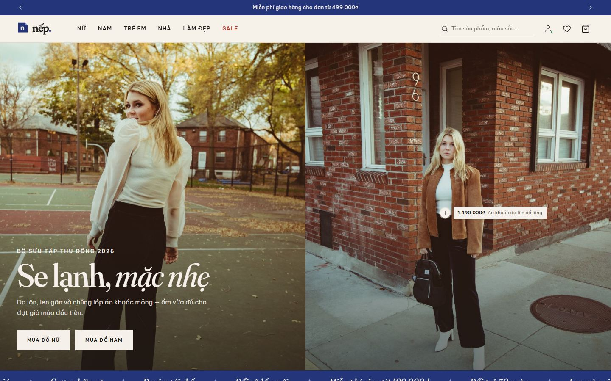

## Ảnh giao diện

| Danh mục & bộ lọc | Chi tiết sản phẩm |
|---|---|
| 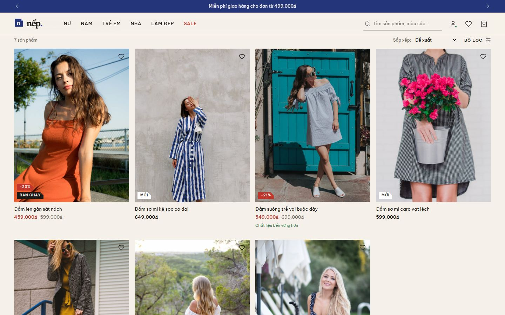 | 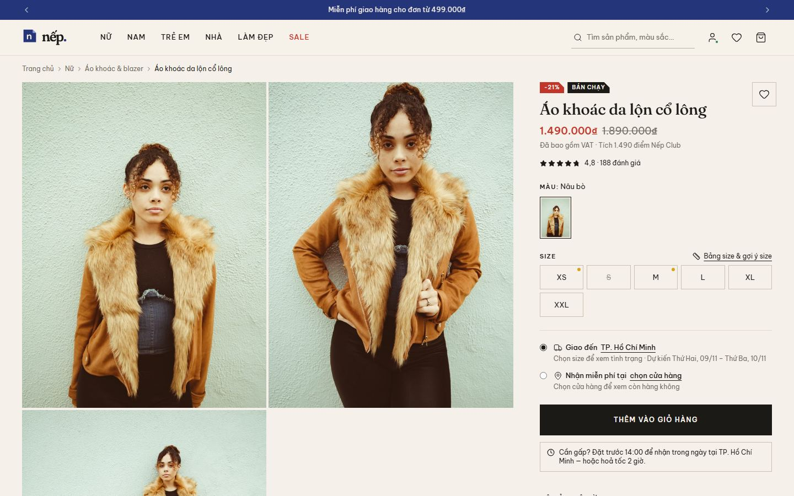 |
| **Gợi ý size theo chiều cao & cân nặng** | **Giỏ hàng** |
| 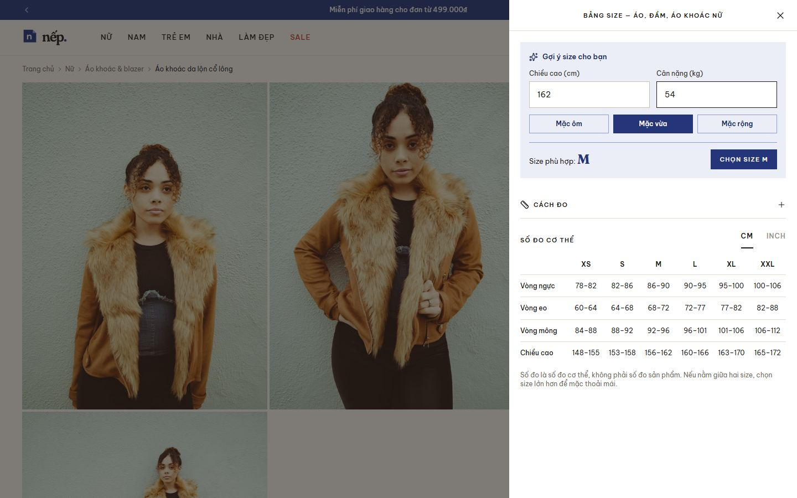 | 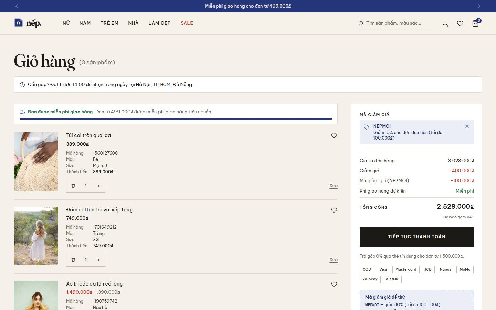 |
| **Thanh toán** | **Tìm cửa hàng** |
| 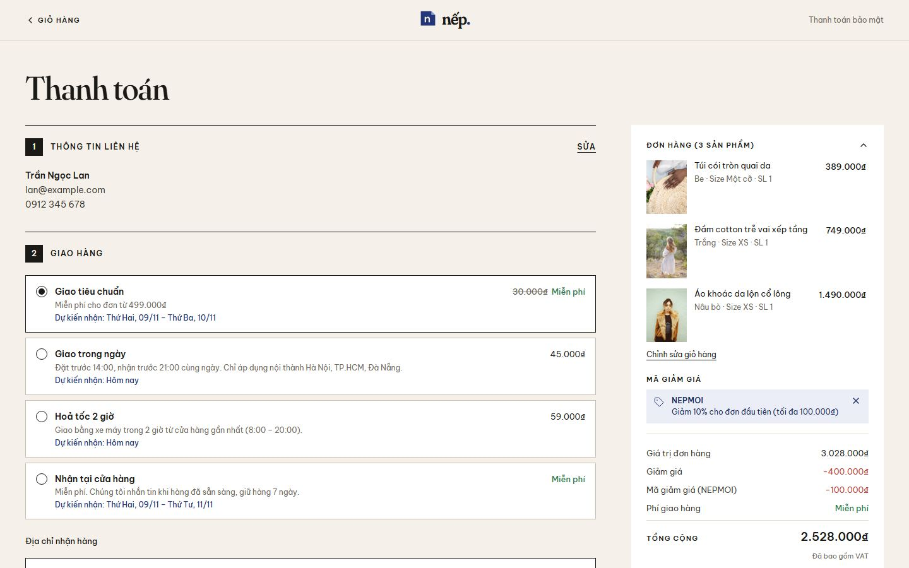 | 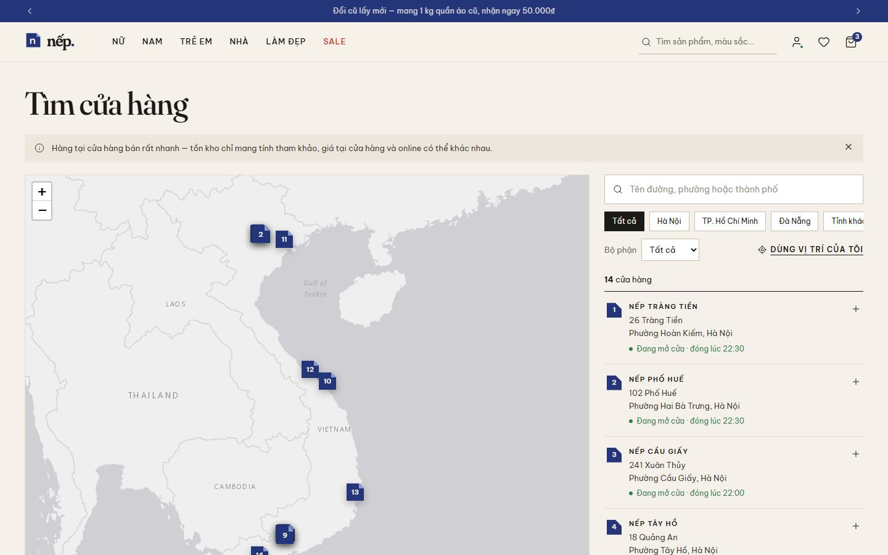 |
| **Tài khoản & ưu đãi** | **Đổi cũ lấy mới** |
| 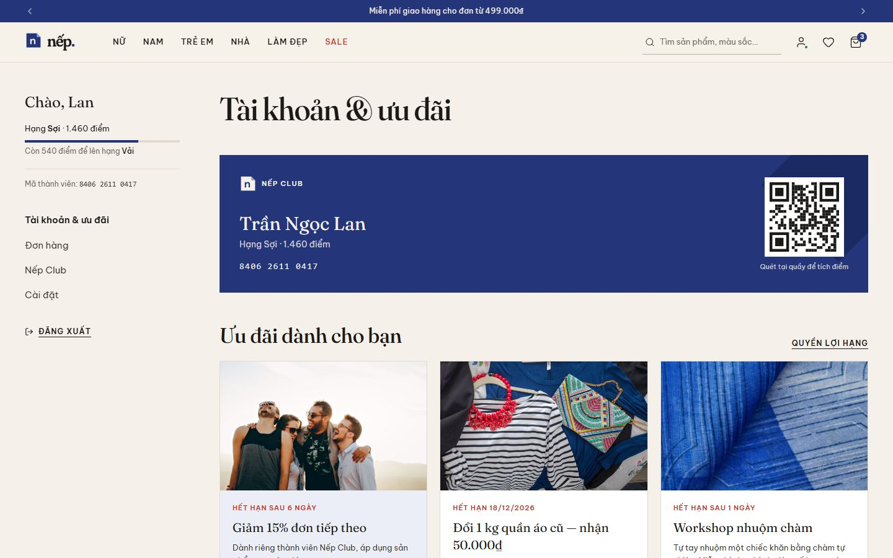 | 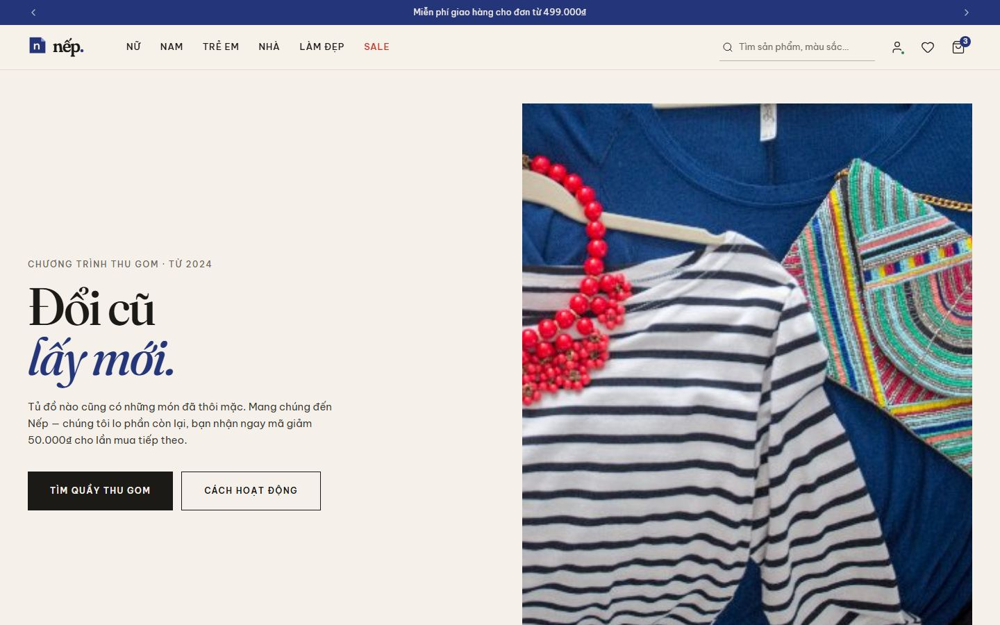 |

<p align="center">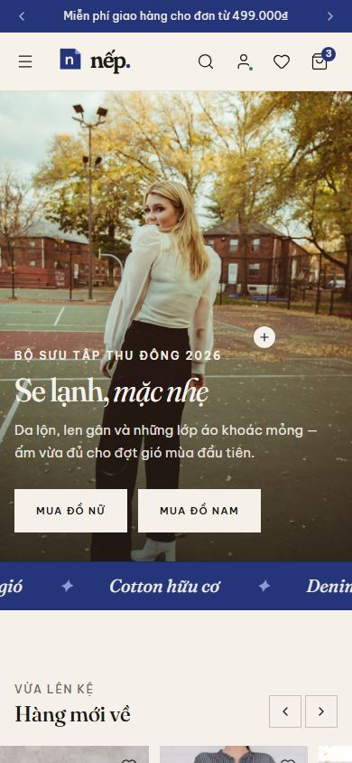 &nbsp; 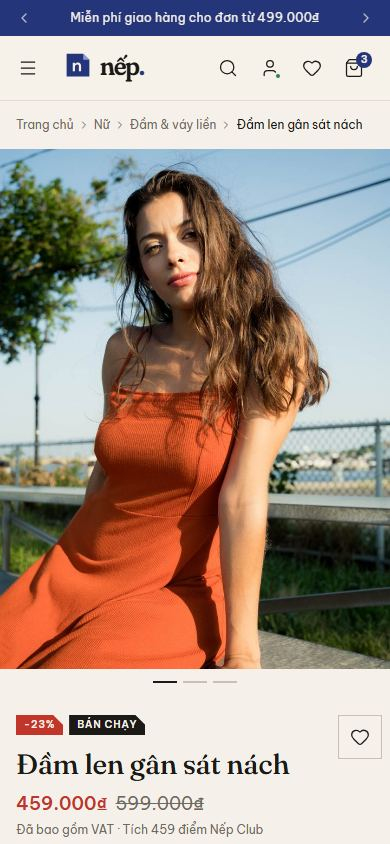</p>

## Tính năng

- **Mua sắm:** trang chủ & trang bộ phận (Nữ, Nam, Trẻ em, Nhà, Làm đẹp), menu lớn, danh mục có tab loại sản phẩm, bộ lọc (giá, màu, size, dáng, chất liệu) đếm kết quả trực tiếp, sắp xếp, "nhận hôm nay tại cửa hàng".
- **Chi tiết sản phẩm:** ảnh theo màu, size còn/hết hàng, **gợi ý size theo chiều cao & cân nặng** (số đo người Việt), báo khi có hàng, đánh giá kèm độ vừa vặn, tồn kho từng cửa hàng, ước tính ngày giao theo tỉnh/thành.
- **Tìm kiếm:** gợi ý tức thì, không phân biệt dấu ("ao so mi" vẫn ra "áo sơ mi"), lịch sử tìm kiếm.
- **Giỏ hàng & thanh toán:** mã giảm giá, miễn phí giao từ 499.000₫, giao tiêu chuẩn / trong ngày / hoả tốc 2 giờ / nhận tại cửa hàng; COD, thẻ, ví điện tử, VietQR, trả góp 0%; khách vãng lai vẫn đặt được hàng.
- **Tài khoản:** đăng nhập "email trước", Nếp Club (hạng Sợi · Vải · Lụa), thẻ thành viên số, đơn hàng online & tại cửa hàng, huỷ đơn có lý do, theo dõi đơn, địa chỉ 2 cấp theo **34 tỉnh/thành sau sáp nhập 2025**, thẻ đã lưu, đăng ký nhận tin (email, SMS, Zalo), đổi mật khẩu, xoá tài khoản.
- **Cửa hàng:** bản đồ 14 cửa hàng (Leaflet, nền Esri), tìm theo khu vực, "dùng vị trí của tôi", giờ mở cửa, chỉ đường.
- **Nội dung:** chương trình **Đổi cũ lấy mới**, trang Nếp Club, đăng ký bản tin, 12 trang hỗ trợ (giao hàng, đổi trả, bảng size…), trang 404.

## Chạy thử

Yêu cầu Node.js ≥ 20.

```bash
cd frontend
npm install
npm run dev        # http://localhost:5195
npm run build      # bản build tĩnh trong frontend/dist
```

Mặc định ứng dụng chạy với **mock server ngay trong trình duyệt** (`VITE_USE_MOCK=true`), dữ liệu thay đổi (giỏ hàng, đơn hàng, tài khoản…) được lưu ở `localStorage`. Muốn làm mới dữ liệu demo: xoá key `nep.mockdb.v1` trong DevTools → Application.

**Triển khai Vercel:** chọn **Root Directory = `frontend`**, framework Vite. `frontend/vercel.json` đã cấu hình điều hướng cho ứng dụng một trang, header bảo mật và cache.

## Kiến trúc

```
H-M/
├── docs/
│   ├── API_CONTRACT.md    ← mô hình dữ liệu + toàn bộ endpoint cho backend
│   ├── DESIGN_SYSTEM.md   ← token màu, chữ, bố cục, thành phần
│   ├── SCREEN_MAP.md      ← ảnh tham khảo → route → tệp
│   └── IMAGE_CREDITS.md   ← nguồn ảnh (CC0)
└── frontend/src/
    ├── api/
    │   ├── http.js            HTTP client duy nhất: gắn token, X-Cart-Id, chuẩn hoá lỗi, chuyển mock ↔ backend
    │   ├── services/*.js      1 hàm = 1 endpoint trong API_CONTRACT.md
    │   └── mock/              mock server + "database" localStorage + seed (sản phẩm, cửa hàng, đánh giá…)
    ├── hooks/                 React Query hooks — lớp duy nhất giao diện dùng để đọc/ghi dữ liệu
    ├── store/ui.js            trạng thái giao diện (zustand): modal đăng nhập, tìm kiếm, khu vực giao hàng, toast
    ├── config/                thương hiệu, menu, 34 tỉnh/thành, bảng size, tài khoản demo
    ├── components/
    │   ├── ui/                design system: Button, Input, Modal, Drawer, Accordion, Tabs, Price…
    │   ├── layout/            Header + menu lớn, SearchPanel, LocationModal, Footer, layouts
    │   ├── product/           ProductCard, ProductListing, FilterDrawer, SizeGuideDrawer, ReviewsDrawer…
    │   ├── home/ cart/ checkout/ account/ auth/ store-locator/ content/
    ├── content/               nội dung trang hỗ trợ
    └── pages/                 mỗi route một tệp (tải theo nhu cầu)
```

Luồng dữ liệu: `Trang → hooks/useX → api/services/x → api/http → (mock server | backend thật)`.

### Nối backend thật

1. Làm backend theo [docs/API_CONTRACT.md](docs/API_CONTRACT.md) (base `/api/v1`, JSON, tiền là số nguyên VND, lỗi dạng `{ error: { code, message, fields } }`). Có thể đọc `frontend/src/api/mock/server.js` như bản hiện thực tham chiếu (kiểm tra dữ liệu, tính phí giao, mã giảm giá, gộp giỏ hàng khách, điểm thành viên…).
2. Tạo `frontend/.env.local`: `VITE_USE_MOCK=false` và `VITE_API_URL=https://api.ten-mien.vn/api/v1`.
3. Khi tắt mock, toàn bộ thư mục `api/mock` không còn được tải.

## Công nghệ

React 19 · Vite 6 · Tailwind CSS v4 (token bằng `@theme`) · React Router 7 (tải trang theo nhu cầu) · TanStack Query 5 · Zustand 5 · React Leaflet · Fraunces & Be Vietnam Pro (đóng gói sẵn, đủ dấu tiếng Việt) · lucide-react.

---

Thiết kế & phát triển bởi **Ntahien Tech** · [ntahientech.com](https://ntahientech.com)
